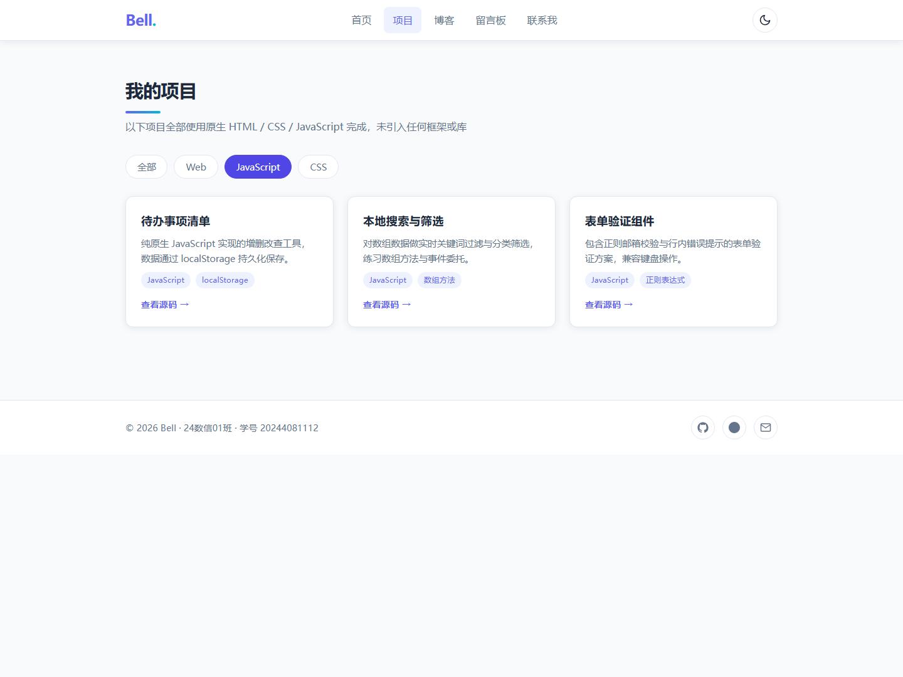
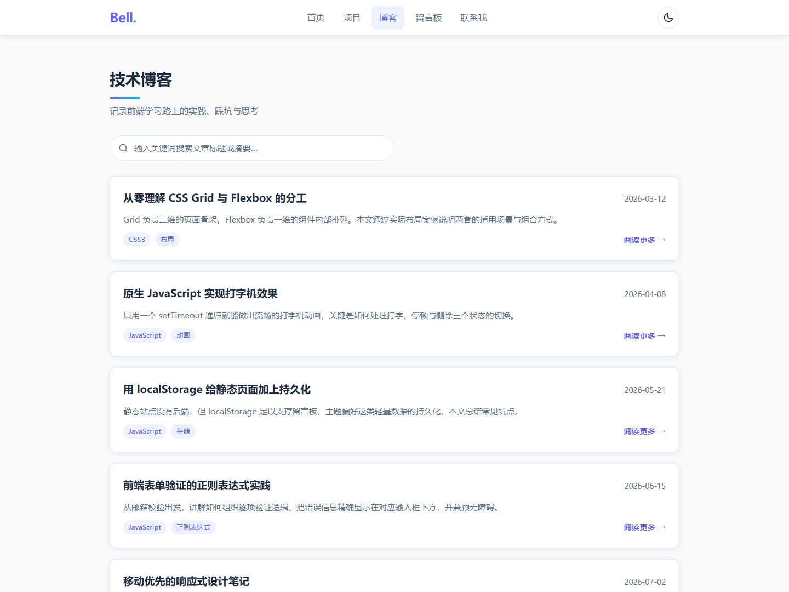
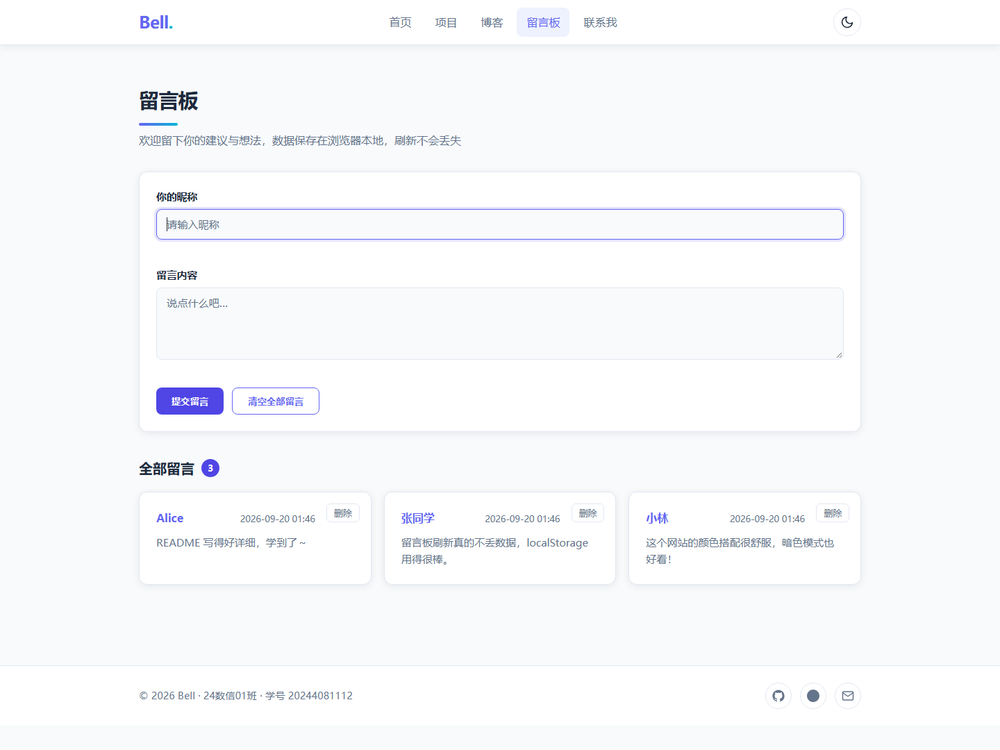
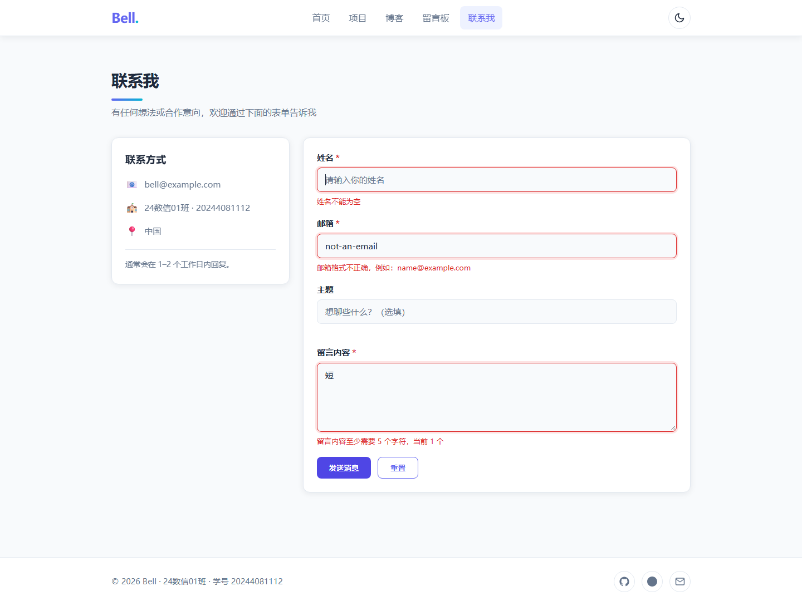
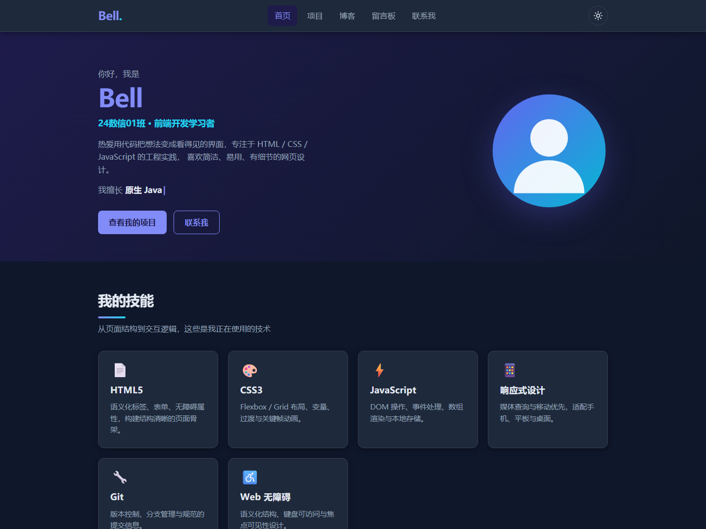

# 个人作品集网站（My Portfolio）

一个使用 **原生 HTML5 + CSS3 + JavaScript** 构建的个人作品集网站，包含 5 个功能完整的页面。
项目**未使用任何框架、库或外部 CDN**，所有图标均为内联 SVG 或 emoji，所有图像均由 CSS 渐变与
内联 SVG 生成，可直接离线运行。

## 在线预览

项目提供两个在线地址（内容完全相同，任选其一访问）：

- **GitHub Pages**：<https://bell-567.github.io/web>
- **Cloudflare Pages**：<https://my-portfolio.pages.dev>　<!-- 部署后替换为实际地址 -->
- **uni-app 多端版（H5）**：<https://bell-567.github.io/web/uniapp/>

**代码仓库**：

- **GitHub**：<https://github.com/Bell-567/web>
- **Gitee**：<https://gitee.com/agsdgasad/web>

> **部署说明**：Gitee Pages 已停止服务，因此在线预览改用 **GitHub Pages** 与
> **Cloudflare Pages** 双线部署（Cloudflare 在国内访问更稳定，可互为备份）。
> 部署步骤见文末。

## 技术栈

| 分类 | 使用到的技术 |
| --- | --- |
| 结构 | HTML5 语义化标签（`header` / `nav` / `main` / `section` / `article` / `aside` / `footer` / `time`） |
| 样式 | CSS3 变量、Flexbox、Grid、媒体查询、过渡、`@keyframes` 动画、`:focus-visible` |
| 脚本 | 原生 JavaScript（ES5 风格，无构建工具）：DOM 操作、事件委托、数组渲染、`localStorage`、正则表达式 |
| 版本控制 | Git（规范化提交信息：`feat` / `fix` / `docs` / `style` / `chore`） |

## 功能特性

### 全站通用
- [x] 顶部固定导航栏，含 Logo、5 个页面链接、主题切换按钮与移动端汉堡菜单
- [x] **暗色模式**：默认跟随系统 `prefers-color-scheme`，手动切换后写入 `localStorage` 并在刷新后保持
- [x] 主题初始化脚本内联于 `<head>`，避免暗色模式刷新时的闪烁
- [x] 响应式布局，使用 `max-width` 断点覆盖 `768px`（平板及以下）与 `480px`（手机）
- [x] 所有可交互元素均具备 `:hover` 与 `:focus-visible` 状态，兼顾键盘可访问性
- [x] 页脚年份由 JavaScript 自动更新为当前年份

### 首页 `index.html`
- [x] Hero 区域：姓名、专业班级、一句话简介、**打字机效果**标语
- [x] 头像使用内联 SVG + CSS 渐变生成，带 `float` 浮动动画
- [x] 6 张技能卡片，Grid 自适应布局，hover 上浮并加深阴影
- [x] 数据统计区块

### 项目页 `projects.html`
- [x] 项目数据以 **JavaScript 数组**存储，由脚本渲染为卡片，不写死 HTML
- [x] 6 个项目，每个含标题、描述、技术标签与源码链接
- [x] 分类筛选按钮（全部 / Web / JavaScript / CSS），点击即时重新渲染
- [x] 筛选结果为空时显示友好提示

### 博客页 `blog.html`
- [x] 文章数据以 JavaScript 数组存储，共 5 篇文章
- [x] 搜索框使用 `input` 事件实现**实时过滤**，同时匹配标题与摘要
- [x] 文章卡片含标题、日期（`<time>` 标签）、摘要、标签与「阅读更多」
- [x] 无匹配结果时显示提示文案

### 留言板 `guestbook.html`
- [x] 基于 `localStorage` 实现留言的**增、删、查、清空**，刷新页面数据不丢失
- [x] 提交后自动清空表单并实时渲染新留言
- [x] 「清空全部留言」按钮，执行前使用 `confirm` 二次确认
- [x] **XSS 防护**：用户输入经 `escapeHTML()` 转义后再渲染，标签不会被解析执行
- [x] 兼容损坏的本地数据（`JSON.parse` 异常时自动重置）

### 联系页 `contact.html`
- [x] 表单字段：姓名、邮箱、主题、留言内容
- [x] 逐项验证：姓名非空、邮箱正则校验、留言内容至少 5 个字符
- [x] 邮箱正则：`/^[^\s@]+@[^\s@]+\.[^\s@]+$/`
- [x] 错误信息显示在**对应输入框下方**（`role="alert"`），不使用 `alert` 弹窗
- [x] 校验通过后显示成功提示，并 `preventDefault()` 阻止默认提交
- [x] 自动聚焦到第一个出错的字段，便于修正

## 项目结构

```
web/
├── index.html          # 首页：Hero、打字机效果、技能卡片
├── projects.html       # 项目展示页：卡片网格 + 分类筛选
├── blog.html           # 博客页：文章列表 + 实时搜索
├── guestbook.html      # 留言板：localStorage 增删查
├── contact.html        # 联系页：表单验证
├── css/
│   ├── style.css       # 全局样式：变量、暗色模式、导航、页脚、动画、响应式
│   └── pages.css       # 页面样式：Hero、技能、项目、博客、留言、表单
├── js/
│   ├── main.js         # 主题切换、汉堡菜单、打字机、年份、项目与文章渲染
│   ├── guestbook.js    # 留言板 CRUD 与 XSS 安全渲染
│   └── validate.js     # 联系表单验证
├── images/
│   └── .gitkeep        # 占位，保持目录被 Git 跟踪
├── README.md
└── .gitignore
```

## 本地运行

本项目为纯静态网站，**无需安装任何依赖或构建步骤**，三种方式任选其一：

**方式一：直接打开**
```bash
# 克隆仓库
git clone https://gitee.com/agsdgasad/web.git
cd web

# 直接双击 index.html，或用浏览器打开
```

**方式二：使用 Python 起一个本地服务（推荐）**
```bash
python -m http.server 8000
# 然后访问 http://localhost:8000
```

**方式三：使用 VS Code**
安装 Live Server 扩展，右键 `index.html` → `Open with Live Server`。

> 使用本地服务器（方式二/三）可以更真实地模拟线上环境，推荐用于演示。

## 浏览器兼容性

已在 Chrome、Edge、Firefox 最新版测试通过。使用了 `CSS 变量`、`Grid`、`:focus-visible`
等现代特性，不支持 IE 11 及更早版本。

## 作者信息

| 项目 | 内容 |
| --- | --- |
| 姓名 | Bell |
| 学号 | 20244081112 |
| 班级 | 24数信01班 |
| 邮箱 | bell@example.com |

## 截图

> 以下为实际运行效果截图（视口 1440×1080）。如需换成自己的内容，按相同文件名覆盖 `images/` 下的图片即可。

### 首页


### 项目页（分类筛选）


### 博客页


### 留言板


### 联系页（表单验证）


### 暗色模式


## 部署说明

本项目是纯静态站点，**无需任何构建命令**，两个平台都可以直接托管。

### 一、GitHub Pages

1. 把代码推送到 GitHub 仓库的 `main` 分支：
   ```bash
   git remote add github https://github.com/<用户名>/web.git
   git push -u github main
   ```
2. 打开仓库页面 → **Settings** → 左侧 **Pages**。
3. **Source** 选择 `Deploy from a branch`，**Branch** 选 `main`，目录选 `/ (root)`，点击 **Save**。
4. 等待 1–2 分钟，访问 `https://<用户名>.github.io/web` 即可。

### 二、Cloudflare Pages

1. 打开 <https://dash.cloudflare.com/> 注册并登录（免费）。
2. 左侧选择 **Workers & Pages** → **Create** → **Pages** → **Connect to Git**，
   授权 GitHub 后选择仓库 `web`。
   > 如果连不上 GitHub，也可以选 **Upload assets**，把整个项目文件夹拖进去直接上传。
3. 构建配置全部留空：
   - **Framework preset**：`None`
   - **Build command**：留空
   - **Build output directory**：`/`
4. 点击 **Save and Deploy**，约 1 分钟后即可通过
   `https://<你的项目名>.pages.dev` 访问。

部署完成后，把两个平台的实际地址替换到本文档「在线预览」一节即可。

1. 打开 <https://dash.cloudflare.com/> 注册并登录（免费）。
2. 左侧选择 **Workers & Pages** → **Create** → **Pages** → **Connect to Git**，
   授权 GitHub 后选择仓库 `web`。
   > 如果连不上 GitHub，也可以选 **Upload assets**，把整个项目文件夹拖进去直接上传。
3. 构建配置全部留空：
   - **Framework preset**：`None`
   - **Build command**：留空
   - **Build output directory**：`/`
4. 点击 **Save and Deploy**，约 1 分钟后即可通过
   `https://<你的项目名>.pages.dev` 访问。

部署完成后，把上面的实际地址替换到本文档「在线预览」一节即可。

## 许可证

本项目为课程作业，仅用于学习与交流。
