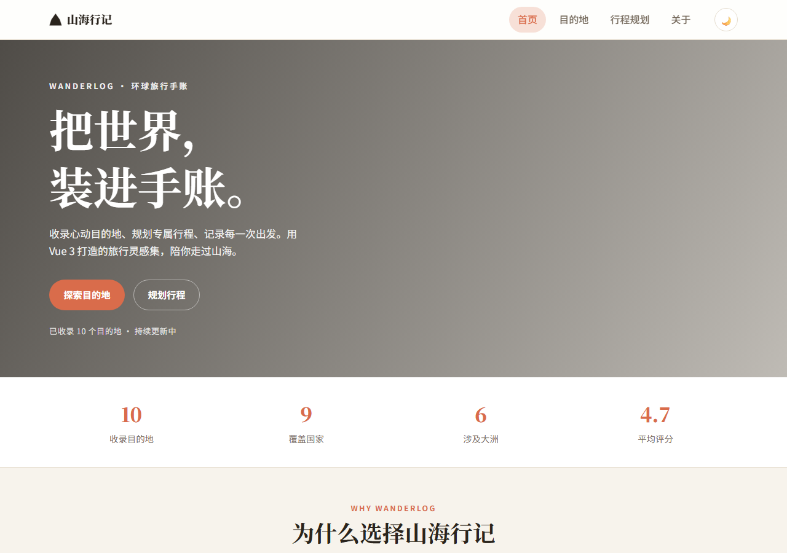
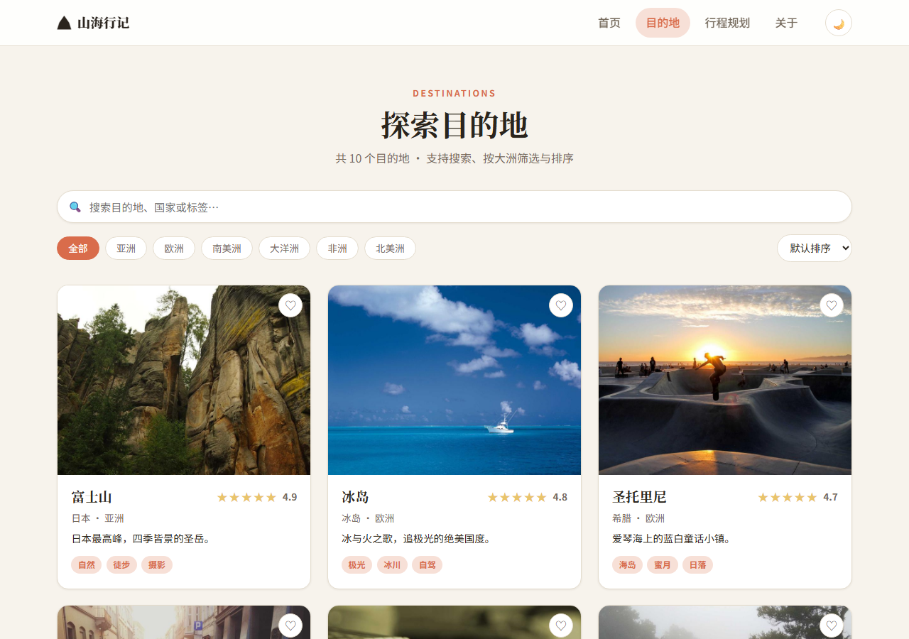
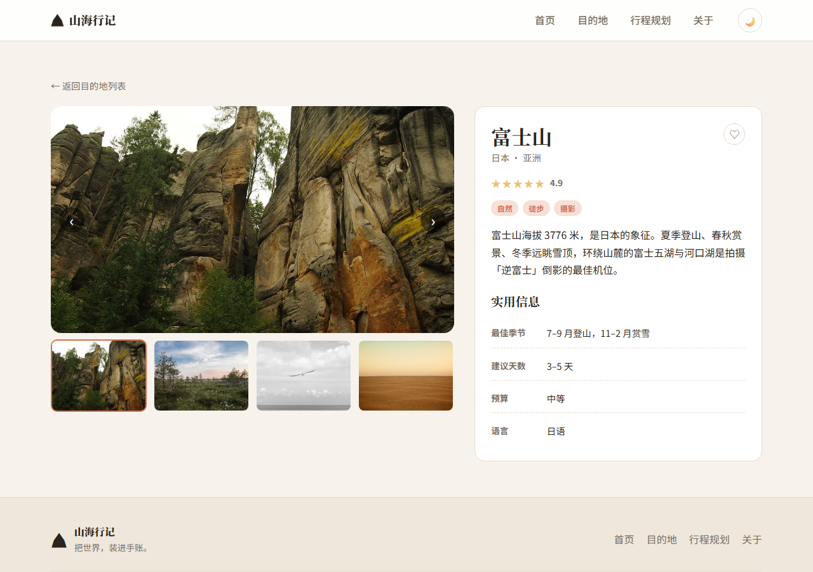
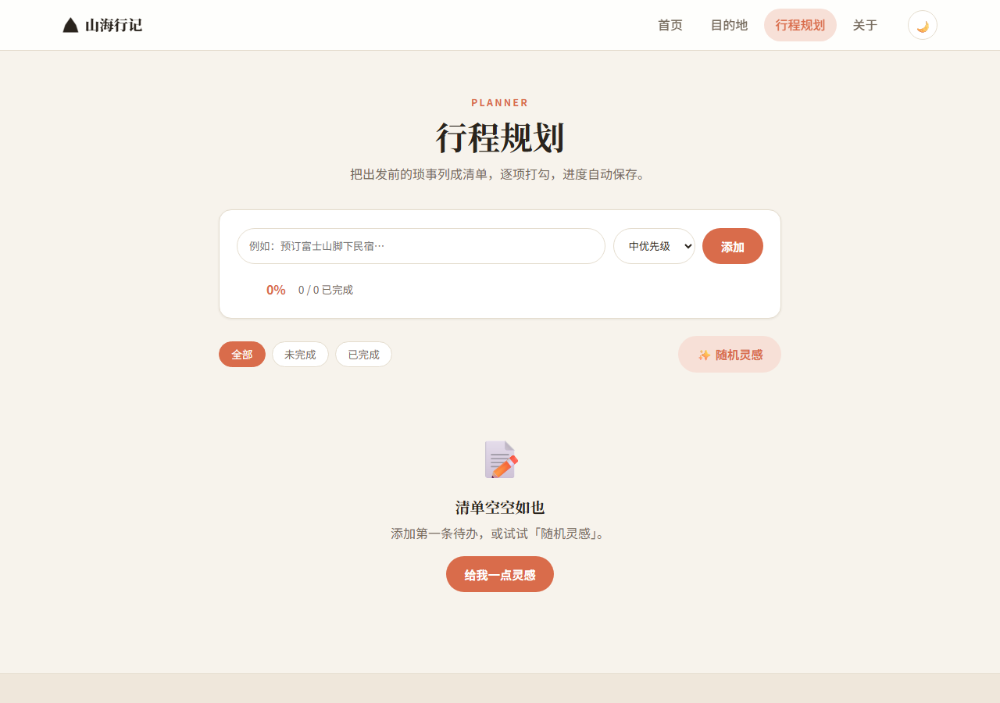
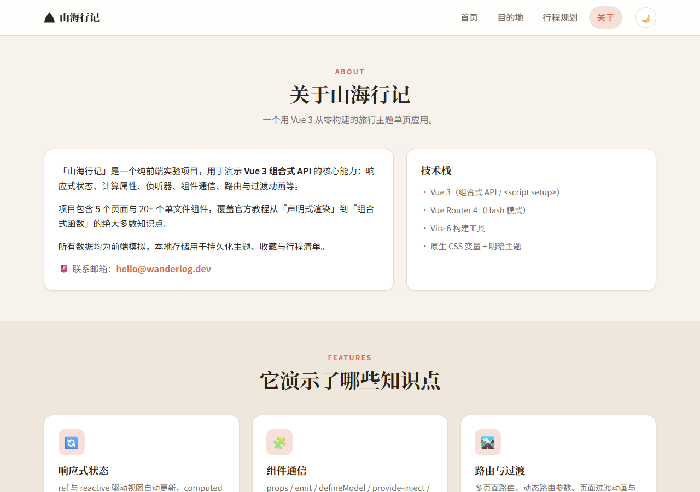
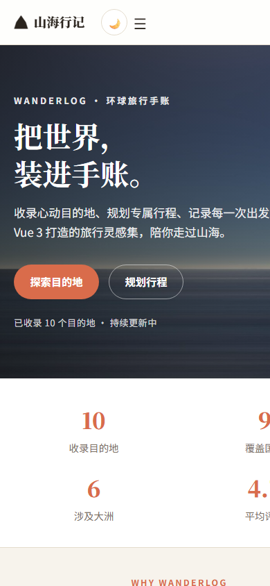

# 实验报告：基于 Vue 的「山海行记 · 环球旅行手账」网站

| 项目   | 内容                             |
| ---- | ------------------------------ |
| 实验名称 | 使用 Vue 实现一个纯前端网站               |
| 网站主题 | 环球旅行手账（目的地图鉴 + 行程规划 + 收藏 + 留言） |
| 完成日期 | 2026-10-25                     |

---

## 一、实验目的

1. 掌握 **Vue 3 组合式 API**（`<script setup>`、`ref`、`reactive`、`computed`、`watch`、生命周期）的使用方法；
2. 掌握 **组件化开发**：组件定义、Props、Emits、插槽、`defineModel`、`provide/inject` 等通信方式；
3. 掌握 **Vue Router** 多页面路由与动态路由参数的用法；
4. 掌握基于 **Vite** 的工程化构建与部署流程；
5. 覆盖 [Vue 官方教程](https://cn.vuejs.org/tutorial/) 的绝大多数知识点，并最终部署到公网。

## 二、实验环境

| 类别    | 名称                 | 版本         |
| ----- | ------------------ | ---------- |
| 操作系统  | Windows 11 Home    | 10.0.26200 |
| 运行时   | Node.js            | 24.20.0    |
| 包管理器  | npm                | 11.19.0    |
| 框架    | Vue                | 3.5.44     |
| 路由    | Vue Router         | 4.6.4      |
| 构建工具  | Vite               | 6.4.5      |
| 编译器插件 | @vitejs/plugin-vue | 5.2.4      |

## 三、实验内容与要求

- 任选主题，使用 Vue 实现一个网站（只需前端）；
- 网站至少包含 **3 个页面**、**15 个 Vue 单文件组件**；
- 技术内容覆盖 https://cn.vuejs.org/tutorial/ 的知识点；
- 提供公网可访问的链接（考虑挂载到 Netlify）。

**完成情况**：网站共 **5 个页面**、**30 个单文件组件**（24 个业务组件 + 5 个视图 + 1 个根组件），覆盖教程全部章节知识点，并提供 Netlify 部署方案。

## 四、系统设计

### 4.1 主题与页面结构

主题「**山海行记 · 环球旅行手账**」，暖色系设计，支持**明/暗双主题**切换，响应式布局适配移动端。

```
山海行记
├── 首页 /                 Hero 横幅、数据统计、特色功能、精选目的地
├── 目的地 /destinations     搜索 + 大洲筛选 + 排序 + 收藏
├── 目的地详情 /destinations/:id   图集、评分、实用信息（动态路由）
├── 行程规划 /planner        待办清单、进度条、localStorage 持久化
└── 关于 /about            项目介绍、知识点说明、留言表单校验
```

### 4.2 项目目录结构

```
vue-app
├── index.html                 # 入口 HTML
├── vite.config.js             # Vite 配置（base: './'）
├── netlify.toml               # Netlify 构建配置
├── package.json
└── src
    ├── main.js                # 应用入口
    ├── App.vue                # 根组件（provide 站点信息 + 路由过渡）
    ├── router/index.js        # 路由配置（Hash 模式）
    ├── assets/styles.css      # 全局主题变量与样式
    ├── data/destinations.js   # 模拟数据（10 个目的地）
    ├── composables/
    │   ├── useTheme.js        # 主题切换（组合式函数）
    │   └── useFavorites.js    # 收藏（跨组件共享状态）
    ├── components/            # 24 个业务组件
    └── views/                 # 5 个页面视图
```

### 4.3 组件清单（24 个业务组件）

NavBar、AppFooter、ThemeToggle、BaseButton、SectionTitle、BackToTop、HeroBanner、StatsBar、FeatureCard、DestinationCard、DestinationList、SearchBar、FilterBar、TagBadge、RatingStars、FavoriteButton、EmptyState、PhotoGallery、FactList、PlannerForm、PlannerItem、ProgressBar、ContactForm、FormInput。

## 五、实现过程与关键代码

### 5.1 响应式状态（ref / reactive）

行程规划页用 `ref` 保存待办数组，留言表单用 `reactive` 保存表单对象：

```js
// PlannerView.vue
const items = ref([])          // ref 包裹数组
function add(payload) {
  items.value.push({ id: Date.now(), text: payload.text, priority: payload.priority, done: false })
}
```

```js
// ContactForm.vue
const form = reactive({ name: '', email: '', message: '' })
const errors = reactive({ name: '', email: '', message: '' })
```

### 5.2 计算属性（computed）

首页统计栏、目的地筛选、行程进度均由 `computed` 从数据源派生，自动缓存、随依赖更新：

```js
// StatsBar.vue —— 从数据源派生统计指标
const stats = computed(() => {
  const countries = new Set(destinations.map((d) => d.country))
  return [
    { label: '收录目的地', value: destinations.length },
    { label: '覆盖国家', value: countries.size },
    // ...
  ]
})
```

```js
// DestinationsView.vue —— 搜索/筛选/排序联动
const filtered = computed(() => {
  const kw = keyword.value.trim()
  let list = destinations.filter((d) => {
    const matchKw = !kw || d.name.includes(kw) || d.tags.some((t) => t.includes(kw))
    const matchRegion = region.value === '全部' || d.region === region.value
    return matchKw && matchRegion
  })
  if (sort.value === 'rating') list = [...list].sort((a, b) => b.rating - a.rating)
  return list
})
```

### 5.3 侦听器（watch）

主题、收藏、行程清单均通过 `watch` 持久化到 `localStorage`，实现跨会话记忆：

```js
// useTheme.js —— 主题变化时同步 <html> 属性并持久化
watch(theme, (value) => {
  document.documentElement.setAttribute('data-theme', value)
  localStorage.setItem(STORAGE_KEY, value)
})

// PlannerView.vue —— 深度监听清单变化自动保存
watch(items, (v) => localStorage.setItem(STORAGE_KEY, JSON.stringify(v)), { deep: true })
```

### 5.4 条件渲染与列表渲染（v-if / v-for）

```html
<!-- NavBar.vue：列表渲染导航 + 收藏数量徽标 -->
<RouterLink v-for="link in links" :key="link.to" :to="link.to" class="navbar__link">
  {{ link.label }}
  <span v-if="link.to === '/destinations' && favoriteCount" class="navbar__badge">{{ favoriteCount }}</span>
</RouterLink>

<!-- ContactForm.vue：提交前后状态切换 -->
<form v-if="!submitted">…</form>
<div v-else class="contact__success">…</div>
```

### 5.5 表单双向绑定（v-model / defineModel）

`SearchBar`、`FilterBar`、`FormInput` 使用 `defineModel` 实现**组件级 v-model**：

```js
// SearchBar.vue
const model = defineModel({ type: String, default: '' })
```

```html
<input ref="inputRef" v-model="model" type="search" placeholder="搜索目的地、国家或标签…" />
```

父组件中直接 `v-model="keyword"` 绑定，双向同步：

```html
<SearchBar v-model="keyword" />
<FilterBar v-model:region="region" v-model:sort="sort" :regions="regions" />
```

### 5.6 组件通信（Props / Emits / 插槽 / provide-inject）

- **Props**：`DestinationCard` 接收 `destination` 对象；
- **Emits**：`FavoriteButton` 通过 `$emit('toggle')` 通知父组件；
- **插槽**：`BaseButton`、`EmptyState` 用默认插槽放置内容与操作按钮；
- **provide/inject**：`App.vue` 用 `provide('site', site)` 注入站点信息，`NavBar`、`AppFooter`、`AboutView` 用 `inject('site')` 消费，避免逐层传递 Props。

```js
// App.vue
const site = reactive({ name: '山海行记', slogan: '把世界，装进手账。', email: 'hello@wanderlog.dev' })
provide('site', site)
```

### 5.7 生命周期与模板引用

```js
// BackToTop.vue —— onMounted 注册滚动监听，onBeforeUnmount 清理
onMounted(() => window.addEventListener('scroll', onScroll, { passive: true }))
onBeforeUnmount(() => window.removeEventListener('scroll', onScroll))

// PlannerForm.vue —— 提交后通过模板 ref 重新聚焦输入框
const inputRef = ref(null)
function submit() {
  emit('add', { text: text.value.trim(), priority: priority.value })
  text.value = ''
  inputRef.value?.focus()
}
```

### 5.8 路由与过渡动画

```js
// router/index.js —— Hash 模式，动态路由参数
{ path: '/destinations/:id', name: 'destination-detail', component: () => import('../views/DestinationDetailView.vue') }
```

详情页读取动态参数并用 `watch` 响应参数变化：

```js
// DestinationDetailView.vue
const dest = computed(() => destinations.find((d) => d.id === route.params.id))
watch(() => route.params.id, () => window.scrollTo({ top: 0 }))
```

根组件用 `<Transition>` 为路由切换添加淡入淡出过渡：

```html
<RouterView v-slot="{ Component }">
  <Transition name="fade" mode="out-in">
    <component :is="Component" />
  </Transition>
</RouterView>
```

### 5.9 组合式函数（Composables）

`useTheme` 与 `useFavorites` 把主题/收藏逻辑封装为可复用的组合式函数，供多个组件共享同一份响应式状态：

```js
// useFavorites.js —— 模块级单例状态，跨组件共享
const favorites = ref(load())
export function useFavorites() {
  const isFavorite = (id) => favorites.value.includes(id)
  const toggleFavorite = (id) => { /* ... */ }
  return { favorites, isFavorite, toggleFavorite }
}
```

## 六、知识点覆盖对照表

| Vue 官方教程知识点                             | 对应文件 / 组件                                                |
| --------------------------------------- | -------------------------------------------------------- |
| 声明式渲染 `{{ }}`                           | 所有组件模板                                                   |
| 属性绑定 `v-bind`（`:src` `:class` `:style`） | DestinationCard、ProgressBar、RatingStars                  |
| 事件监听 `v-on`（含修饰符 `.prevent` `.enter`）   | PlannerForm、PlannerItem、各类按钮                             |
| 表单绑定 `v-model`（原生 + 组件 `defineModel`）   | SearchBar、FilterBar、FormInput、ContactForm、PlannerForm    |
| 条件渲染 `v-if / v-else / v-show`           | NavBar、EmptyState、ContactForm、PlannerItem                |
| 列表渲染 `v-for`（含 `:key`、遍历对象）             | DestinationList、StatsBar、NavBar、FactList                 |
| 计算属性 `computed`                         | StatsBar、DestinationsView、PlannerView、NavBar、ContactForm |
| 侦听器 `watch`（含 `deep`、`immediate` 场景）    | useTheme、useFavorites、PlannerView、DestinationDetailView  |
| 模板引用 `ref` / `defineExpose`             | SearchBar、PlannerForm                                    |
| 生命周期钩子 `onMounted / onBeforeUnmount`    | BackToTop、PlannerView                                    |
| Props 传值                                | FeatureCard、DestinationCard、RatingStars 等                |
| 事件 `emits`                              | FavoriteButton、DestinationCard、PlannerForm 等             |
| 插槽（默认 / 具名）                             | BaseButton、EmptyState、FeatureCard、HeroBanner             |
| `provide / inject` 依赖注入                 | App.vue → NavBar / AppFooter / AboutView                 |
| 组合式函数（Composables）                      | useTheme、useFavorites                                    |
| 动态组件 + `<Transition>` 过渡                | App.vue                                                  |
| Vue Router（多页面、动态路由、scrollBehavior、懒加载） | router/index.js、各 View                                   |
| 响应式 `ref / reactive`                    | 全项目                                                      |

## 七、运行与部署

### 7.1 本地运行

```bash
cd vue-app
npm install
npm run dev      # http://localhost:5173
npm run build    # 输出 dist/
```

### 7.2 部署到 Netlify（公网链接）

[山海行记 · 环球旅行手账](https://lively-meerkat-88b796.netlify.app/#/)

## 八、实验结果（运行截图）

### 首页（桌面端）



### 目的地列表页



### 目的地详情页



### 行程规划页



### 关于 / 留言页



### 首页（移动端 390×844，响应式验证）



## 九、实验总结

### 9.1 主要收获

1. 完整走通了 Vue 3 组合式 API 的工程化开发流程：从脚手架、组件拆分到路由、状态持久化与构建部署；
2. 深入理解了 `ref` 与 `reactive` 的区别与适用场景，掌握了 `computed`（派生数据）与 `watch`（副作用）的分工；
3. 掌握了组件通信的完整工具箱：Props / Emits / 插槽 / `defineModel` / `provide-inject`，并能按场景选择合适的方案；
4. 通过 `defineModel`（Vue 3.4+）让自定义组件像原生表单元素一样支持 `v-model`，代码更简洁。

### 9.2 遇到的问题与解决

| 问题                                 | 解决方案                                                  |
| ---------------------------------- | ----------------------------------------------------- |
| 收藏按钮位于 `<RouterLink>` 内部，点击会触发路由跳转 | 将按钮移出链接、作为绝对定位的兄弟节点，改用组件自身 `toggle` 事件                |
| 纯静态托管下 History 路由刷新会 404           | 改用 **Hash 模式**路由，无需服务端重写即可在 Netlify Drop 等任意静态托管正常工作  |
| 主题/收藏/清单需要跨会话保存                    | 用 `watch` 深度监听 + `localStorage` 持久化，模块级 `ref` 实现跨组件共享 |
| 移动端导航栏溢出                           | 媒体查询下折叠为汉堡菜单，`v-if` 切换展开/收起，`is-open` 类控制过渡           |

### 9.3 可改进方向

- 接入真实后端 API 替换本地模拟数据；
- 引入 Pinia 管理更复杂的全局状态；
- 图片改用真实目的地素材（当前为占位图服务 picsum）；
- 补充单元测试（Vitest）与端到端测试。

---

**说明**：本项目源码位于 `vue-app/` 目录，可直接 `npm install && npm run dev` 复现上述全部效果。
